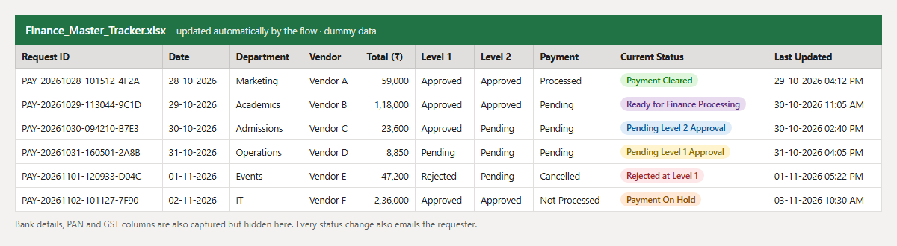
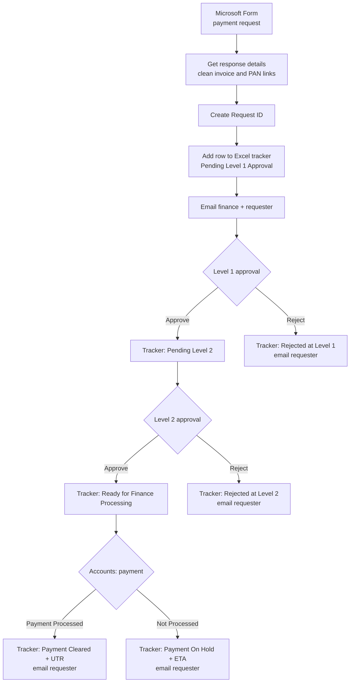

# Finance Request Approval Flow (Power Automate)

A Microsoft Power Automate flow that turns a vendor payment request into a fully tracked, three-stage approval: form submission, two approval levels, payment processing with UTR capture, an Excel master tracker that updates itself, and an email to the requester at every step.

*The screenshot uses dummy data. No vendor, bank, employee or company details are included in this repository.*

## The problem

Payment requests came in over email and chat. Finance had to collect invoices, PAN and bank details, chase two approvers, tell the accounts team when to pay, and keep a spreadsheet up to date by hand. Requests got lost, nobody knew the current status, and approvals had no audit trail.

## The solution

One Microsoft Form starts everything. The flow:

1. Reads the form response, including the uploaded invoice and PAN card.
2. Creates a unique Request ID and adds a row to the **Finance Master Tracker** (Excel Online).
3. Emails finance and the requester, then sends a **Level 1 approval**.
4. On approval, updates the tracker and sends a **Level 2 approval**.
5. On approval, sends a **payment processing** task to accounts with two buttons: *Payment Processed* or *Payment Not Processed*, with a mandatory UTR or ETA comment.
6. Updates the tracker and emails the requester with the final outcome.

Every rejection or hold is written to the tracker and emailed to the requester, so no request stays "Pending" forever.

## How it works

## Status values in the tracker

| Current Status | Set when |
| --- | --- |
| Pending Level 1 Approval | Request submitted |
| Pending Level 2 Approval | Level 1 approved |
| Ready for Finance Processing | Level 2 approved |
| Payment Cleared | Accounts marked *Payment Processed* (UTR in Finance Remarks) |
| Payment On Hold | Accounts marked *Payment Not Processed* (ETA and reason in Finance Remarks) |
| Rejected at Level 1 / Level 2 | An approver rejected; their remarks are saved |

## What the form collects

Department, requester, vendor type and name, PAN, GST, amount without GST, GST amount, total, payment reason, expected payment date, bank account holder, account number, IFSC, invoice upload, PAN card upload and cancelled cheque link.

## Repository contents

| Path | What it is |
| --- | --- |
| `flow/definition.json` | The full flow definition (Logic Apps workflow schema), cleaned of IDs and emails |
| `docs/TRACKER_COLUMNS.md` | Excel tracker columns the flow reads and writes |
| `docs/tracker-preview.png` | Dummy-data view of the tracker |

## Setup

1. Create the Microsoft Form and an Excel table with the columns in [docs/TRACKER_COLUMNS.md](docs/TRACKER_COLUMNS.md).
2. In Power Automate, create an automated flow from the form trigger and rebuild the steps from `flow/definition.json` (the form question IDs such as `r14e75…` must be replaced with your own form's IDs).
3. Replace the placeholders: `YOUR_FORM_ID`, `YOUR_DRIVE_ID`, `YOUR_FILE_ID`, `YOUR_TABLE_ID` and the `@example.com` addresses.
4. Connect Microsoft Forms, Excel Online (Business), Approvals and Office 365 Outlook.

## Improvements made for this public version

- **Payment step fixed:** the payment approval uses custom buttons, so its outcome is *Payment Processed*, not *Approve*. The condition now checks the right value; before, a processed payment was never marked as cleared.
- **Rejections handled:** both approval levels and the payment step now update the tracker and email the requester when the answer is no. Before, these branches were empty.
- **Unique Request IDs:** the ID was a month plus a random number from 100 to 999, which can repeat and update the wrong tracker row. It now uses the date, time and a short GUID.
- **"Approved At" filled:** approval emails read the approval date from the row-insert step, where it was still blank. They now use the actual approval time.

## Tech

Microsoft Power Automate, Microsoft Forms, Excel Online (Business), Approvals (basic and custom response), Office 365 Outlook, Parse JSON, workflow expressions (`concat`, `formatDateTime`, `convertTimeZone`, `guid`).

## Author

Abhishek Kumar, Revenue Operations & Automation Analyst.
